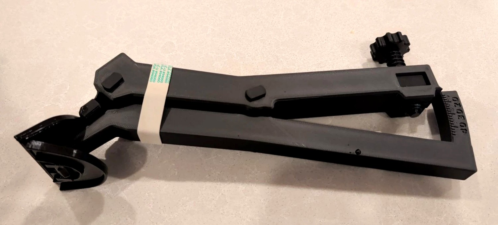

# open-wide: a printable jaw stretcher

A hand-squeezed jaw-opening (trismus) stretcher that prints in PETG with no hardware besides the printed parts.



**Printing, assembly and use: <https://nocnokneo.github.io/open-wide/>**

> **This is a hobby design, not a medical device.**
> Nobody has tested, certified or clinically reviewed it, and stretching a jaw can cause injury.
> Build and use it at your own risk, and ask your clinician first.

Status: one copy printed (Bambu P1S, PETG) and in use by the author.

## How it works

| Goal | How |
| --- | --- |
| The lower mouthpiece follows the jaw's curved path | The main pivot is placed so the lower tray's hinge follows the modelled jaw path within 0.8 mm from 18 to 42 mm of opening |
| The mouthpieces stay flat on the teeth | The lower tray swings freely on a hinge under the teeth and levels itself |
| The mouthpieces fit the teeth | Horseshoe trays with a rimmed channel for the teeth |
| The opening has an adjustable limit | Thumbscrew between the handles, with a millimetre scale; hard stop at 46 mm |

Every joint is a pin or a hook, so nothing slides under load.
A sliding joint would carry a large sideways load here, and in printed plastic it would lose a third or more of the squeeze to friction and could stick open.

The jaw is modelled as rotating about a point 78 mm behind and 4 mm below the upper incisal edge, which gives the usual path: straight down at first, then back by about 14 mm at 45 mm of opening.


## What is checked

`make.py` rebuilds every STL and render and fails if any check does.
Results are in `report.txt`.

* No two parts overlap at any opening from closed to 46 mm, including the pins, screw and nut.
* The lower tray stays hooked at every tilt up to 150°, against a working maximum of 51°.
* The nut threads onto the screw, and the thread has the handedness set in `design.py`.
* Every STL is watertight and fits a 250 mm bed.

By hand calculation, bending stress in the thinnest part of the lever (inside the mouth) is about 13 MPa at 100 N on the teeth, against roughly 45–50 MPa yield for PETG.
100 N is well above a normal stretching force.

## Changing the design

Every dimension is a named field of `Design` in `design.py`.

```
uv venv --python 3.12 .venv
uv pip install --python .venv/bin/python -r requirements.txt
.venv/bin/python make.py
```

| Path | Contents |
| --- | --- |
| `design.py` | Parameters, kinematic layout, side profiles |
| `kinematics.py` | Jaw model and pivot fit |
| `parts.py` | 3D parts |
| `assembly.py` | Poses and collision checks |
| `make.py` | Checks, STL export, renders |
| `docs/` | The guide, served by GitHub Pages |
| `publishing/` | Listing text for the model-sharing sites |

## Releasing

Pushing a tag `v1`, `v2`, … publishes a GitHub release with the STLs zipped (`.github/workflows/release.yml`).
The model-sharing sites have no upload API, so update them by hand from that zip: see `publishing/listing.md`.

## Numbers

* Page visits and button clicks: <https://open-wide.goatcounter.com>.
* STL downloads per release: `gh api repos/nocnokneo/open-wide/releases --jq '.[] | "\(.tag_name) \(.assets[0].download_count)"'`
* Repository views and clones for the last 14 days: the repo's Insights → Traffic page.

## License

* Python source: MIT, see `LICENSE`.
* STL models, images and documentation: CC BY 4.0, see `LICENSE-CC-BY-4.0`.
