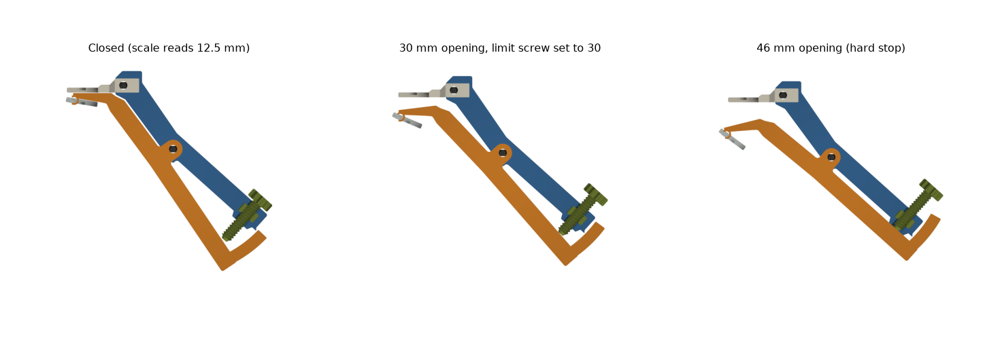

# open-wide: a printable jaw stretcher

A hand-squeezed jaw-opening (trismus) stretcher that prints in PETG with no hardware besides the printed parts.
It is modelled on what the OraStretch Press does, not on how it does it.

**Status: one copy printed (Bambu P1S, PETG) and in use by the author.**
Other printers and settings are untested, so go through [First print checks](#first-print-checks).
The split nuts are newer than that print.

This is a hobby design, not a medical device: see [Disclaimer](#disclaimer).



## What it does

| OraStretch feature | This design |
| --- | --- |
| Lower mouthpiece follows the jaw's curved path | The main pivot is placed so the lower tray's hinge follows the modelled jaw path within 0.8 mm from 18 to 42 mm of opening |
| Mouthpieces stay flat on the teeth | The lower tray swings freely on a hinge under the teeth and levels itself |
| Contoured mouthpieces | Horseshoe trays with a rimmed channel for the teeth |
| Adjustable limit | Thumbscrew between the handles, with a millimetre scale; hard stop at 46 mm |

The OraStretch gets its curved path from a curved "piston" arm that slides through a channel in the base (US 2007/0287598 A1).
That joint carries a large sideways load, and in printed plastic it would lose a third or more of the squeeze to friction and could stick open.
Here every joint is a pin or a hook, so nothing slides under load.

The jaw is modelled as rotating about a point 78 mm behind and 4 mm below the upper incisal edge, which gives the usual path: straight down at first, then back by about 14 mm at 45 mm of opening.

## Parts and printing

All STLs in `stl/` are already oriented for printing, and none needs supports.

| File | Print | Notes |
| --- | --- | --- |
| `base.stl` | 1 | On its side. Two short internal bridges (pivot pocket, mouthpiece socket). |
| `lever.stl` | 1 | On its side, scale facing up. 241 mm long: place it along the bed. |
| `upper_mouthpiece.stl` | 1 | Flat side down. |
| `lower_tray.stl` | 1 | Rims up, hinge bar on the bed. |
| `limit_screw.stl` | 1 | Standing on its knob. Add a brim. |
| `limit_nut_1_dot.stl`, `_2_dot`, `_3_dot` | 1 each | Flat. Three fits of the same nut, loosest to tightest; see [First print checks](#first-print-checks). |
| `pivot_pin_print_2.stl` | 2 | Lying on its flat. Print a spare. |
| `hinge_fit_test.stl` | optional | The lever tip only, to check the hinge fit before the long print. |

Settings:

* PETG, 0.2 mm layers, 0.4 mm nozzle.
* 5 walls and 5 top/bottom layers on every part: the bending loads run in the walls.
* 25 % gyroid infill, or more.
* Roughly 150 g of filament in total (estimated from the solid volumes, not sliced).

## Assembly

1. Slide the chosen nut into the pocket near the end of the base handle and run the limit screw down through it from the top.
   The thread is left-handed: turn the knob anticlockwise to screw it in.
2. Put the lever's pivot hump into the pocket under the base and push a pin through until it clicks.
3. Push the upper mouthpiece's tang into the socket in the base head and pin it.
4. Hook the lower tray on: hold it folded back over the lever tip (about 165° from its working position, rims facing up and forward), slide the hinge bar into the hook, and swing the tray forward under the tip.
   It cannot come off at any angle it can reach in the mouth.
5. Line the tooth channels (see [Pads](#pads)).

## Setting the limit

The scale is on the curved tab at the end of the lever handle.
Read it at the pointer on the end of the base handle.

1. Squeeze the handles until the screw stops them.
2. Turn the screw until the pointer reads the opening you want as a maximum.
   Clockwise raises the limit, anticlockwise lowers it.

The scale runs from 14 to 46 mm in 2 mm ticks, and one turn of the screw is about 4 mm of opening.
It assumes bare trays and the jaw model above, so check it once: squeeze to the stop and measure between the two tooth surfaces at the front with calipers.
Pads add twice their thickness to the real opening.

## Use

* The device needs about 13 mm of opening to go in.
* Rest the upper teeth in the upper tray, let the lower tray settle on the lower teeth, and squeeze.
* The hand squeezes about 1.3 times as hard as the teeth are pushed.
* Releasing the handles releases the stretch at once: nothing in the mechanism can hold it open.
* Follow the stretching schedule from your own clinician or therapist; this design does not come with one.
* Stop on sharp or unexpected pain, and do not use it with loose teeth, recent jaw fracture or surgery, or jaw infection without clearance.

### Pads

Bare PETG is hard on tooth edges.
Line both channels with something soft before use: self-adhesive silicone or EVA foam strip (1–2 mm), or a strip cut from a boil-and-bite mouthguard and moulded to your teeth.

### Cleaning

Wash with dish soap and a soft brush, then air dry.
PETG softens near 80 °C, so no dishwasher and no boiling.
The trays are cheap to reprint.

## First print checks

1. Print `hinge_fit_test.stl` and `lower_tray.stl`.
   The tray must hook on as described, swing freely through about 60°, and not pull off in any working position.
   If the hinge is tight, raise `hook_inner_radius_mm` or `hook_mouth_clearance_mm` in `design.py` by 0.1.
2. Print all three nuts and keep the tightest one the screw still turns in by hand.
   The nuts are split so that a tight one grips the screw and the setting does not drift when the device is carried.
   The dots on top give the fit: one is loosest.
   If none suits, change `nut_thread_clearance_by_dots_mm`.
3. The pins should click in with firm thumb pressure and turn freely.
4. Try the trays on your teeth before lining them.
   The arches (`upper_arch`, `lower_arch`) and channel widths are for an average adult and are easy to change.
5. Before trusting it in the mouth, squeeze the assembled device hard against a folded towel between the trays and look for whitening or cracks at the lever tip and around the pins.

## What was checked

`python make.py` rebuilds everything and fails if any check does.
Results are in `report.txt`.

* No two parts overlap at any opening from closed to 46 mm, including the pins, screw and nut.
* Every nut threads onto the screw, and the thread is left-handed.
* The lower tray stays hooked at every tilt up to 150°, against a working maximum of 51°.
* Every STL is watertight and fits a 250 mm bed.
* Bending stress in the thinnest part of the lever (inside the mouth) is about 13 MPa at 100 N on the teeth, against roughly 45–50 MPa yield for PETG.
  100 N is well above a normal stretching force.

## Disclaimer

This is a hobby design shared as-is, with no warranty.
It is not a medical device, and it has not been tested, certified or reviewed by any clinician or regulator.
Stretching a jaw can cause injury.
Build and use it at your own risk, and ask your clinician first.

## Changing the design

Every dimension is a named field of `Design` in `design.py`.

```
uv venv --python 3.12 .venv
uv pip install --python .venv/bin/python -r requirements.txt
.venv/bin/python make.py
```

| File | Contents |
| --- | --- |
| `design.py` | Parameters, kinematic layout, side profiles |
| `kinematics.py` | Jaw model and pivot fit |
| `parts.py` | 3D parts |
| `assembly.py` | Poses and collision checks |
| `make.py` | Checks, STL export, renders |

## License

* Python source: MIT, see `LICENSE`.
* STL models, images and this document: CC BY 4.0, see `LICENSE-CC-BY-4.0`.
