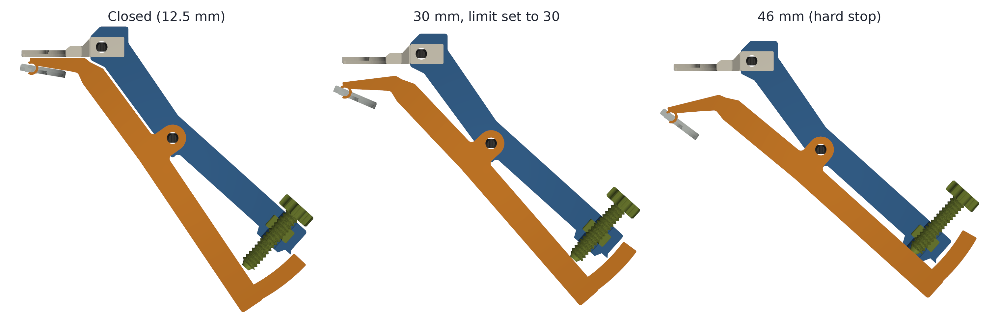
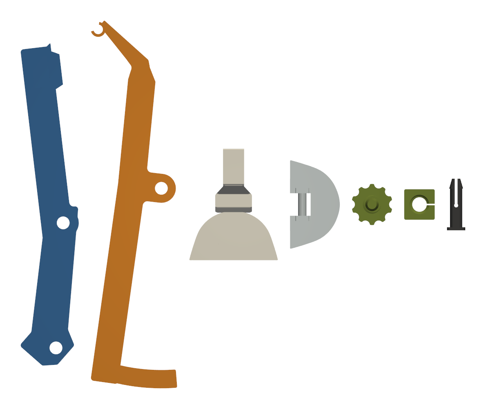
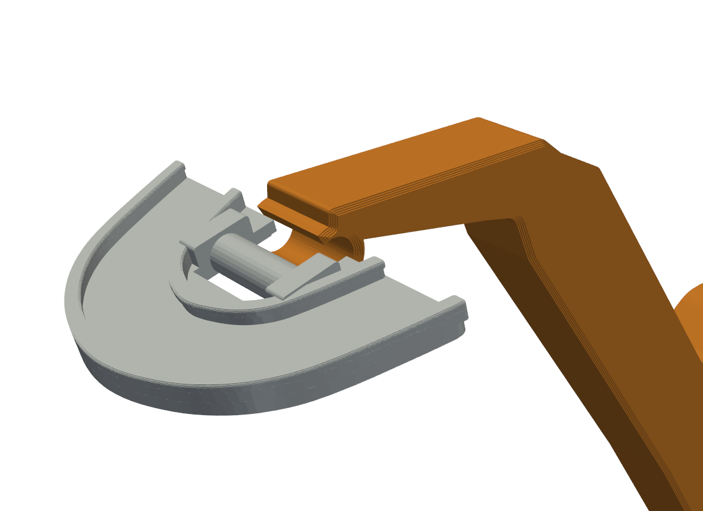
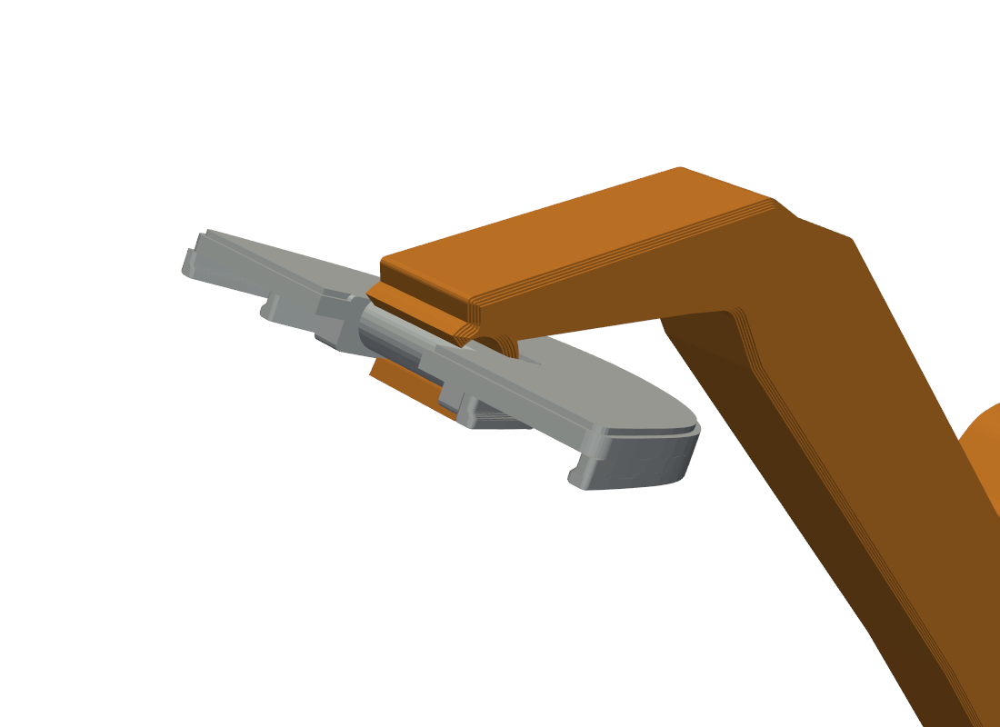
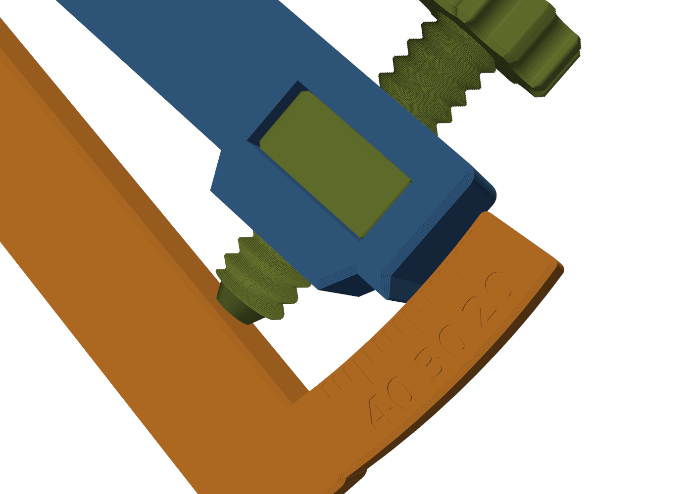
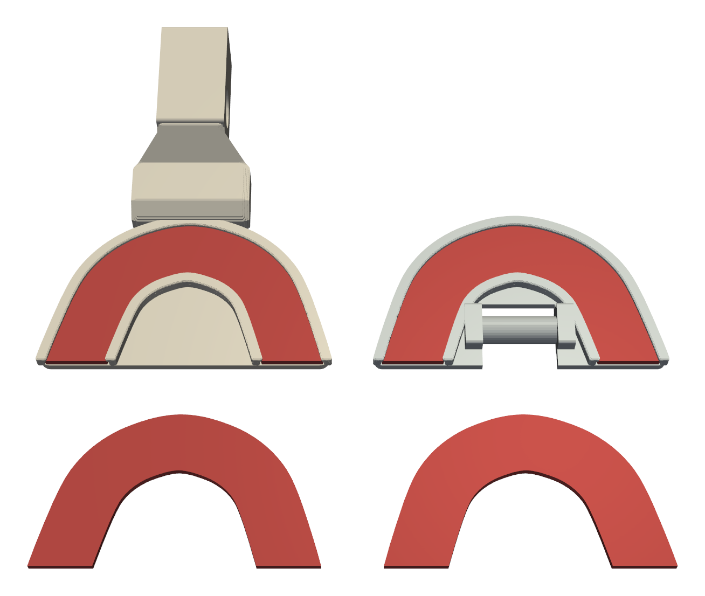

> **This is a hobby design, not a medical device.**
> Nobody has tested, certified or clinically reviewed it, and stretching a jaw can cause injury.
> Build and use it at your own risk, and ask your clinician first.

## What it is

Squeeze the handles and the two mouthpieces push your teeth apart, gently and under your control.
It is meant for the daily stretching that jaw-opening rehab (trismus) calls for.

* **It moves the way a jaw moves.** The lower mouthpiece swings down and back along the jaw's own arc instead of straight down.
* **It sits flat on your teeth.** The lower tray pivots freely and levels itself.
* **You set the limit.** A thumbscrew stops the handles at the opening you choose, from 14 to 46 mm, read off a scale.
* **Everything is printed.** Eight parts, no screws, no springs, no supports.

## Print

[Download the STLs]({{ site.stl_zip_url }}){: data-goatcounter-click="download-stls"}.
They are already turned the right way up, and none needs supports.

| File | Copies | How it sits on the bed |
| --- | --- | --- |
| `base.stl` | 1 | On its side |
| `lever.stl` | 1 | On its side, scale facing up. It is 241 mm long, so lay it along the bed |
| `upper_mouthpiece.stl` | 1 | Flat side down |
| `lower_tray.stl` | 1 | Rims up |
| `limit_screw.stl` | 1 | Standing on its knob. Add a brim |
| `limit_nut.stl` | 1 | Flat |
| `pivot_pin_print_2.stl` | 2 | Lying on its flat. Print a spare |
| `tooth_pads.stl` | Optional | Flat. See [Pads](#pads) |

Settings:

* PETG, 0.2 mm layers, 0.4 mm nozzle.
* 5 walls and 5 top and bottom layers on every part. The walls carry the load.
* 25 % gyroid infill, or more.
* Roughly 150 g of filament.

## Assemble

No tools needed.

1. **Fit the screw.**
   Slide the nut into the pocket near the end of the base handle, then screw the limit screw down through it from the top.
   The nut is split so that it grips the screw and your setting stays put in a bag.

2. **Join the handles.**
   Put the lever's round hump into the pocket under the base and push a pin through until it clicks.

3. **Add the upper mouthpiece.**
   Push its tang into the socket at the front of the base and pin it.

4. **Hook on the lower tray.**
   Fold the tray right back over the lever tip, rims up, and slide its bar into the hook.

   

   Then swing it forward under the tip.
   It can no longer come off in any position it can reach in your mouth.

   

## Set your limit

The scale is on the curved tab at the end of the lever handle, and the pointer is on the end of the base handle.

1. Squeeze the handles until the screw stops them.
2. Turn the screw until the pointer shows the widest opening you want.
   Clockwise lowers the limit and anticlockwise raises it, about 4 mm per turn.

The scale is a guide, not a measurement.
Check it once: squeeze to the stop and measure between the two tooth surfaces at the front.

## Use

* You need about 13 mm of opening to get it in.
* Rest your upper teeth in the upper tray, let the lower tray settle on your lower teeth, and squeeze.
* Your hand squeezes about 1.3 times as hard as your teeth are pushed.
* Let go and the stretch is gone. Nothing in the mechanism can hold your mouth open.
* Follow the stretching schedule your own clinician or therapist gave you.
* Stop at sharp or unexpected pain.
* Do not use it with loose teeth, a recent jaw fracture or surgery, or a jaw infection unless your clinician has cleared it.

### Rubber band

A rubber band around both arms just behind the mouthpieces, as in the photo at the top, pulls the device shut when you let go.
It is optional.

### Pads

Bare PETG suits some teeth and not others.
If it feels hard, add a soft pad to each tray.
Both trays take the same pad, either way up, and a small lip on each rim holds it down by its edges.
`tooth_pads.stl` holds two of them, and there are two ways to use it.

**Cut the pads from sheet.**
Use silicone sheet, 1.6 mm (1/16 in) thick and 50A hardness or softer.
Food-grade sheet cites FDA 21 CFR 177.2600.
Print `tooth_pads.stl` in any material and use a print as the template.

1. Lay the template on the sheet, trace round it with a fine pen and cut along the line with sharp scissors.
2. Tuck one edge of the pad under its lip, then work the other edge under the other lip until the pad lies flat.

**Print the pads.**
Print `tooth_pads.stl` in TPU and fit the pads the same way.
The usual 95A TPU is firm; 85A is softer.

Whichever you use:

* Pads add twice their thickness to the real opening, and to the 13 mm you need to get the device in.
* Check both pads are seated before every use and replace a torn one.
  A loose piece in the mouth is a choking hazard.

### Cleaning

Wash it with dish soap and a soft brush, then let it air dry.
PETG softens near 80 °C, so no dishwasher and no boiling.
The trays are cheap to reprint.

## If something does not fit

Printers differ, so a first print can need a nudge.
Each fix below is one number in `design.py`; the [README](https://github.com/nocnokneo/open-wide#changing-the-design) explains how to rebuild the STLs.

| Problem | Fix |
| --- | --- |
| The lower tray will not hook on, or does not swing freely | Raise `hook_mouth_clearance_mm` or `hook_inner_radius_mm` by 0.1 |
| The screw is too loose to hold its setting, or too stiff to turn | Lower or raise `nut_thread_radial_clearance_mm` by 0.05 to 0.1 |
| The trays do not suit your teeth | Change `arch` or `channel_width_mm` |
| A pad pops out, or will not go under the lips | Raise or lower `pad_lip_overhang_mm` |

Before it goes in your mouth, squeeze the assembled device hard against a folded towel between the trays.
Look for whitening or cracks at the lever tip and around the pins, and reprint anything that shows them.
